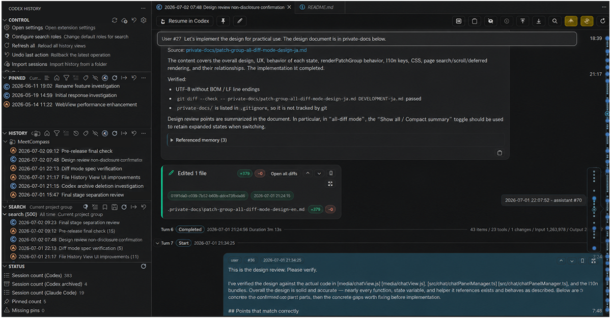
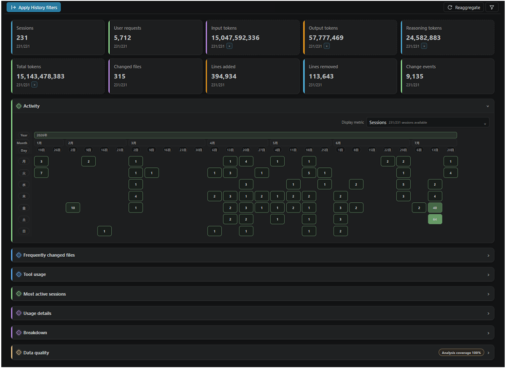
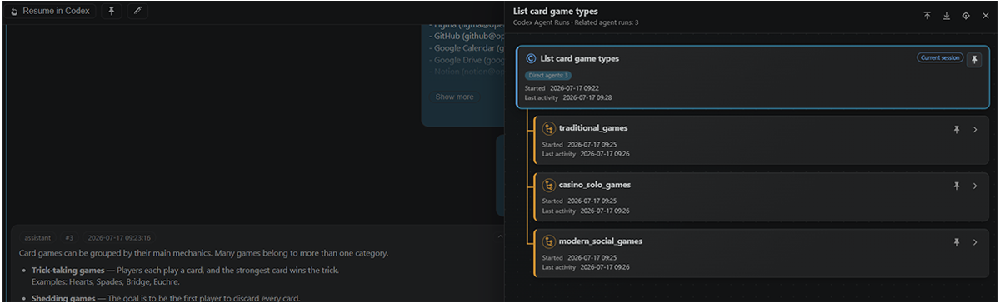
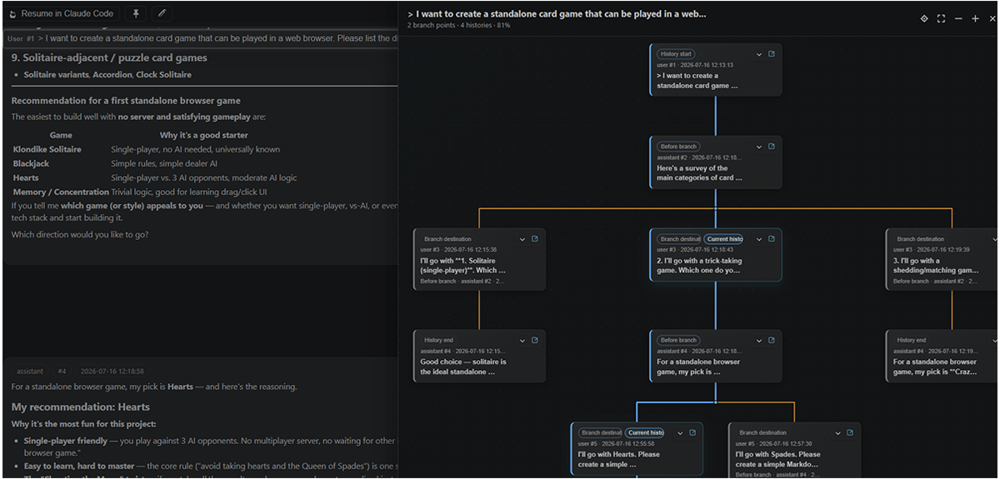

# Codex History Viewer - Codex and Claude Code

Browse, search, organize, and resume past Codex CLI / Claude Code sessions through the official VS Code extensions or prepared CLI commands.

Latest release: **2.21.0** (2026-11-12).

## Why Use This Extension?

Codex and Claude Code sessions can become hard to revisit once they are no longer active in the editor. Codex History Viewer keeps those local session files useful by presenting them in a searchable session history browser inside VS Code.

Use it to find past prompts, reuse useful answers, inspect file changes, organize sessions with tags and notes, resume same-source sessions, and prepare handoff context for other AI tools.

## Highlights

- **Revisit past Codex CLI and Claude Code sessions** that are no longer easy to access from the active editor flow.
- Browse sessions in a year / month / day tree, a sortable session list, or project views with related project groups.
- Choose independent startup defaults for History and Pinned, or restore each workspace's previous view state.
- Open History Insights to review activity, token usage, file changes, and breakdowns by source, model, project, and tool.
- Optionally include Codex `archived_sessions`, hide sessions without changing provider files, and switch among active, archived, and hidden display targets.
- Optionally read compressed Codex histories (`.jsonl.zst`) in History, Search, the Session Viewer, History Insights, and File AI Change History. (Experimental; disabled by default.)
- Show valid cached History and Pinned data immediately at startup while local session files refresh in the background.
- Search across prompts, responses, tool output, tags, notes, and attachment metadata, with shared search history.
- View sessions in the Session Viewer with Markdown, including individually copyable tables, GFM task lists, Mermaid diagrams, code highlighting, math rendering, tool cards, and file-change diffs.
- Manage the extension's primary settings from a categorized settings page, with supported User, Workspace, and Workspace Folder targets, scope-specific JSON backups, maintenance actions, and project resource links.
- Enable an opt-in turn timeline for Codex and Claude Code sessions to see turn boundaries, turn summaries, completed-turn folding, and running state in live mode, with optional displays for remaining Codex usage limits and credits.
- Use Agent Runs to distinguish Codex and Claude Code sub-agent sessions and inspect parent, sibling, and descendant relationships in a right-side tree, with additional items loaded on request. (Disabled by default.)
- Use Branch Navigation to inspect and switch between locally forked Codex histories, histories before and after Codex prompt edits, and Claude Code **Fork conversation** histories in their respective session views. (Disabled by default.)
- Show Codex / Claude Code request interruptions as dedicated timeline cards.
- Identify commands entered in Claude Code's shell mode with a **Terminal input** badge and view their results in **Terminal output** cards.
- Read progress updates and expandable thinking text saved in Claude Code histories, with search, bookmarks, copying, and Markdown export.
- Inspect Claude Code task notifications with expandable details.
- View files sent by Claude Code with their names, descriptions, and delivery status, and open local files from their names.
- Open File AI Change History for a workspace file, including directly from a Session Viewer diff card, to review Codex / Claude Code diffs that touched that file.
- Bookmark important history cards and use date-guide markers to revisit them quickly.
- Optionally display Claude Code extension bookmarks as read-only marks in a different color from this extension's own bookmarks.
- Keep open session tabs up to date with header-controlled auto-refresh modes.
- Switch an open Session Viewer between a dedicated tab and a temporary tab from its header.
- Show supported image attachments, Claude Code documents, and file references from Codex / Claude Code sessions as compact cards.
- Organize sessions with pins, tags, notes, custom titles, project aliases, project associations, saved searches, search history, display modes, and filters.
- Keep Pinned filters independent from History/Search, including project scope, source, visibility, tags, and saved sort preferences.
- Experimental opt-in restoration for session tabs, File AI Change History, History Insights, and the dedicated settings page after Reload Window or VS Code restart.
- Resume past sessions through the official Codex and Claude Code VS Code extensions or prepare commands for resuming them with the CLI.
- Copy session IDs and session file paths from the Session Viewer or tree context menus, and reveal session files in their containing folders.
- Export and restore original session data together with extension-managed metadata such as tags, notes, custom titles, hidden state, pins, and timeline bookmarks.
- Create handoff files and prompts when moving work to another AI tool, and copy the handoff file path directly.

## Quick Start

1. Open the Activity Bar and select **Codex History**.
2. Use **Control > Open Settings** to choose history sources and session folders.
3. Browse **History** and use its **...** menu to change the layout, filters, and sort order.
4. Select a session to open it. Use the header toggle or **Open Session in Dedicated Tab** to keep it in a dedicated tab.
5. Use **Pinned** for saved sessions and **Search...** to find past messages.
6. Use the session's **Resume** action to continue work with Codex or Claude Code.

See the [Command Reference](docs/commands.md) for additional actions.

## History and Pinned Organization

History and Pinned support **List View** and **Project View**, scoped to **All Project Groups** or **Current Project Group**.

To choose each view's startup behavior and defaults, see [Startup Display](#startup-display).

Use project context menus to add aliases or associate related projects without changing or moving the original history files.

History, Pinned, and History Insights can target **Active Only**, **Active + Archived**, **Archived Only**, **Hidden Only**, or **All** sessions when the corresponding sources are available. Hidden sessions can come from either active or archived storage. Hidden and archived states are identified in tree descriptions and tooltips.

History also has a **Compression** filter with **Compressed + Uncompressed**, **Compressed Only**, and **Uncompressed Only** choices. It is available in the pane's **...** menu and **Filter History...**. Search and History Insights follow this History condition; Pinned keeps its independent filters. **Compressed Only** requires compressed Codex histories to be enabled.

The Command Palette groups History and Pinned view options into **Filter...**, **Change Sort Order...**, and **Change Presentation...** commands for each view. Individual options remain available in the pane menus, and existing command IDs remain usable in custom keybindings.

Pinned has independent project, source, visibility, date, tag, and sort settings, so saved sessions can stay focused on a different set of histories from History and Search. Both views support sorting by dates, names, and session file size.

Use **Show timestamp** and **Show project/path** under **History List > Session rows** to simplify session rows in History, Pinned, and Search. The two elements can be hidden independently, while their full timestamp and project information remain available in session tooltips.

## Session Viewer

The Session Viewer renders local session files as readable timelines. It supports Markdown, Mermaid diagrams, syntax-highlighted fenced code blocks, KaTeX-compatible math, assistant usage metadata, environment snapshots, tool execution metadata, and grouped file-change cards from patch activity. GFM task-list markers render as read-only checkboxes without modifying the stored session content.

Use **Open Session as Markdown** for a transcript document.

Markdown tables use clearer cell spacing and separators, wrap long content, and scroll horizontally within the table when needed. Each table has an action for copying only that table in its original Markdown form.

Fenced `mermaid` blocks render as inline diagrams. Each diagram can switch between Light and Dark display modes, open in a non-modal right-side pane for fit-to-view, zoom, scroll, drag-to-pan, and keyboard navigation, and be saved as SVG, PNG, or Mermaid source (`.mmd`).

Choose Extension, CLI, or both as the resume method separately for Codex and Claude Code. CLI actions prepare a command in a new terminal for review; press Enter to run it.

If a Codex prompt edit creates a new history file, the Session Viewer stays on its current file. Use **Go to main history** to switch to the edited continuation.

The Session Viewer and **Session Information** context menus can copy session IDs and file paths or reveal the session file.

Tree context menus provide actions for individual sessions and multi-selection. See [Session Actions](docs/commands.md#session-actions) for supported commands and selection rules.

The toggle next to **Custom Title** switches between dedicated and temporary tabs while preserving the current view state. Selecting another history reuses a temporary tab unless that history is already open. Pinning is a separate action.

Large histories can use the `auto`, `normal`, or `simplified` performance mode. Heavy tool details and large diff rows can be deferred until **Show details** is enabled or an individual entry is expanded.

Codex and Claude Code sessions can use an opt-in turn timeline. `basic` mode shows turn start/end markers, range rails, summaries, token counts, duration, and manual folding for completed turns. `live` mode adds running-turn indicators, elapsed time, and update activity effects.

For Codex, use **Open Settings > Session View > Usage limits** to select **Weekly limit**, **5-hour limit**, and **Credits** individually. This setting is off by default and requires Basic or Live turn timeline mode. Selected items appear at the end of completed or folded turn summaries and at the right of the running turn's timeline row in Live mode.

Hover over or focus an item to see its recorded time.

The displayed percentages and credit balances reflect the values saved in local session history when each turn ran and may differ from your current remaining allowance or credit balance.

Each selected item uses its last valid value recorded in the same turn, including after completion. If that turn has no value for a selected item, it shows `-`. Values are not carried across turns.

Patch group cards provide file summaries and **Open all diffs** / **Close all diffs** actions. With the turn timeline enabled, changes are grouped into one diff card per turn.

Use **File AI Change History** on a diff card to open the workspace file's history at that change.

Claude Code file changes use recorded edit results to distinguish applied changes from failed, interrupted, or unapplied edits. Overwrites are treated as updates to existing files. Unconfirmed or incomplete records are labeled, and unconfirmed changes do not contribute to confirmed History Insights totals.

Request interruptions from Codex and Claude Code appear as dedicated timeline cards. Recognized Claude Code session and agent shutdown notices are excluded from ordinary user-message search and request counts.

Claude Code cross-session messages, **Task notification**, and **Internal reminder** cards keep internal traffic separate from human requests. Notification details can be expanded and copied.

Claude Code compaction summaries and Codex page-selection context are available in detail views. Messages and tool results preserved during compaction in Claude Code child-agent histories are available in the viewer, search, and statistics.

Progress updates and thinking text saved in Claude Code histories also appear in the timeline without enabling **Show details**. Progress updates are shown directly, while thinking text is expandable. Both support search, bookmarks, copying, and Markdown export.

**Additional user input** cards show user text sent while Claude Code was running.

To display read-only bookmarks from the Claude Code extension in main histories, enable **Open Settings > History Sources > Claude Code > Display Claude Code bookmarks**. The Claude Code source and **Show date guide and bookmarks** must also be enabled. These marks are blue, separate from this extension's yellow bookmarks, and managed in Claude Code.

Session tabs preserve their view state across reloads and auto-refresh. The experimental **Restore extension tabs after reload** setting can also restore session tabs, including multiple temporary tabs and their tab modes, plus File AI Change History, History Insights, and settings after a window reload or VS Code restart. It is off by default because VS Code may delay restoration or create duplicate tabs when the same history is reopened.

Long Codex histories load referenced earlier history when available. Missing or unreadable references produce an incomplete-history notice.

The session timeline can keep the current user prompt visible at the top while you scroll. Codex memory citation information recorded for intermediate and final responses is rendered as a collapsible section instead of being left as raw metadata in the message body. Session runtime context and local-command output are likewise shown as collapsed cards instead of raw user messages.

## Attachments and References

The Session Viewer keeps attachments and file references out of the message body and renders them as cards instead.

- Supported images from Codex / Claude Code sessions, including Codex tool-output and image-generation images, are loaded on demand and can be previewed or saved. Separately recorded intermediate and final images remain visible in history order.
- Claude Code PDF, text, and generic documents render as document cards. Text document previews open inside the card, and embedded payloads are saved on demand.
- Files sent by Claude Code show their names, descriptions, and recorded delivery status, including pending results, success, delivery warnings, and errors. Clicking a valid file name opens the local file in VS Code. File contents are not loaded automatically, including images.
- Claude Code pasted text and automatically truncated long input render as text document cards when the local prompt-history record can be matched unambiguously. Pasted-image placeholders use the corresponding session image metadata. If the auxiliary record cannot be verified, the primary session text remains visible.
- Claude Code IDE opened-file and selection markers render as file/selection reference cards instead of raw inline tags.
- Codex mentioned- and pasted-file blocks render as file reference cards while only an explicit request remains as message text. Attachment-only pasted requests remain card-only, including blocks that appear after IDE context.
- File reference cards can open local files through VS Code. Referenced files are not read automatically for rendering, search, resume, or handoff.
- On Windows, Claude Code scratchpad links under the current user's local Claude temporary directory can still open when the generated relative link crosses drives.
- Card metadata such as path, MIME type, and size is available from tooltips instead of taking over the session timeline.
- Markdown transcripts, resume text, and handoff files use clean text plus attachment summaries instead of repeating raw tags or file blocks.

For files sent by Claude Code, Search includes recorded file paths and descriptions when tool-call content is enabled, and recorded results when tool-output content is enabled. Sending a file counts as a tool call in History Insights; it does not create a file-change entry in History Insights or File AI Change History.

## Search

Search is local, cancellable, and backed by an incremental search index. It can search message text, configured tool metadata, titles, tags, notes, and attachment metadata.

Updates that rebuild cached data may make the first history load, search, or analysis slower. Large histories require additional RAM and disk space.

Saved Claude Code progress updates and thinking text are included in the Assistant role. Selecting a matching result opens the corresponding card and expands thinking text when needed. In-page search also includes collapsed thinking text.

Supported query forms include normal substring search, `exact:...`, `re:...`, `/regex/`, and boolean `AND` / `OR` / `NOT`.

Search follows the current History target, including date, project scope, project filter, source, visibility, tags, and compression. **Hidden Only** searches hidden sessions, while **All** searches both visible and hidden sessions. Search does not follow Pinned filters, and it does not create Search results from filters alone.

**Save Current Search...** saves a query alone or together with its filters. **Run Saved Search...** reapplies saved filters to History and Search; query-only presets use the current History filters. Saved searches are shared across projects, while Pinned filters remain independent. Presets that require disabled sources or history types cannot run until those features are enabled.

Opening a search result can pass its query to the viewer's in-page search, which supports the same query syntax. Search history is shared across Search, the Session Viewer, and File AI Change History.

Project aliases are shown in Search scope and result display, but they are not added to the search index or treated as searchable hit text.

The search index can be tuned with `codexHistoryViewer.search.indexToolContent`:

- `conversationOnly`
- `toolCalls`
- `toolCallsAndOutputs`

Attachment indexing includes labels, paths, MIME types, file kinds, and bounded text from Claude Code text documents. PDF / Office / binary / base64 document contents, raw image Base64 or data URI payloads, and Codex referenced-file contents are not indexed.

## Codex Archived Sessions

Codex History Viewer can optionally read Codex `archived_sessions` in addition to normal Codex `sessions`. The visibility target can show active sessions, visible sessions from active and archived storage, archived sessions, hidden sessions, or all sessions. Search follows the History visibility target, while Pinned keeps its own independent visibility state. Active Codex sessions expose **Move to Archive**, while archived Codex sessions expose **Move to Codex History**.

Archive and restore operations prefer the official Codex provider. Moving archived sessions back to normal Codex history can fall back to a filesystem move when the official provider is unavailable. Pins, annotations, bookmarks, and saved session positions are relocated when the session path changes.

Use **Hide Sessions** and **Show Sessions** from History, Pinned, or Search to change extension-local visibility without modifying the original session file. Hiding works for sessions in both active and archived storage. Hidden sessions remain available in File AI Change History.

## Compressed Codex Histories (Experimental)

Enable **Include compressed Codex histories** (`codexHistoryViewer.codex.compressedSessions.enabled`) under **History Sources** to include Codex `.jsonl.zst` files. The setting is disabled by default and carries a resource-impact badge because decompression uses CPU and memory. Compressed files in the archive also require archived Codex sessions to be enabled.

When enabled, compressed histories are available to the history lists, Session Viewer, Search, History Insights, and File AI Change History. Use **History > ... > Compression** or **Filter History...** to show compressed histories, uncompressed histories, or both. If the same history exists as both `.jsonl` and `.jsonl.zst`, the uncompressed file takes precedence.

The extension uses a bundled WebAssembly decoder, with no external decompression command or runtime download. Reading does not create decompressed copies on disk or retain a separate cache of the complete decompressed text. Existing search and analysis caches still store derived data. Compressed reads are limited to 1 GiB of decoded data per file read; invalid or oversized streams stop with an error.

This feature reads histories already compressed by Codex. It does not add a command for compressing existing histories. Turning it off preserves the original files, pins, and annotations.

## Session Data Export and Restore

**Export Sessions** can save either a sanitized Markdown transcript or the original session data. **Export original session data** includes the provider session files and extension-managed metadata for tags, notes, custom titles, hidden state, pins, and bookmarks for messages and other timeline entries.

Read-only bookmarks displayed from the Claude Code extension are separate from extension-managed metadata and are not included in metadata exports or restored by **Import Sessions**.

**Import Sessions** can restore the session data and its metadata together, or restore only the selected part when that option is available. For Codex sessions, the active or archived storage location is also restored. A confirmation summarizes the planned session-data and metadata changes before anything is written.

Original-data export and import preserve compressed Codex files. If an import overwrites an existing history stored in the other format, the incoming data is converted to the destination's format before replacing it. Markdown export produces a readable transcript from either format.

## Handoff to Other AI

Handoff actions appear under **Handoff to Other AI** for eligible active Codex / Claude Code sessions when `codexHistoryViewer.handoff.enabled` is enabled. They can create a reusable handoff file, copy a prompt that points another AI to that file, copy the handoff file path to the clipboard, or open the handoff file for manual use. Codex sessions can also be handed off directly to Claude Code when the Claude Code extension is available.

After a handoff file is created, the completion notification can open the file, copy the handoff prompt, or copy the generated file's absolute path to the clipboard.

Handoff files are stored in this extension's VS Code global storage and include a tail-prioritized transcript excerpt, the latest user request, the source session path, recoverable file changes, and attachment summaries. Tool calls, tool outputs, and binary attachment payloads are intentionally omitted.

The saved text used for Claude Code progress and thinking cards is omitted from handoff files. Progress reports recorded as ordinary assistant messages remain eligible for the transcript excerpt, subject to its length limit.

When project associations are configured, handoff generation follows the associated project display and includes path mapping context for the receiving AI.

## File AI Change History

File AI Change History starts from a workspace file and shows the Codex / Claude Code changes that touched that file over time.

Use it when you want to answer questions such as:

- Which AI session changed this file?
- How did this file evolve across Codex and Claude Code sessions?
- What was the surrounding session context for a specific diff?

Open this view with the **File AI Change History** icon on a Session Viewer diff card, or run **Show File AI Change History** for a workspace file. The Explorer file context menu entry is opt-in: enable **File Change History > Explorer Context Menu: Enabled** to use it from Explorer.

The view is scoped to the current workspace and selected file. It supports Codex / Claude Code source toggles, in-page search with shared query history and richer query syntax, incremental **Load more**, previous/next navigation, and **Open in History** links back to the matching diff card in the original session. Diff code is syntax-highlighted when the language can be determined from the file path; otherwise, it is displayed as plain text.

File AI Change History follows project associations when resolving related history, so associated project displays and path mappings are reflected when possible. Hidden sessions remain part of its candidate history.

## History Insights

History Insights turns the current History target into a fixed analytics snapshot. Open it from **Show History Insights** in the History view header or from the Command Palette.

The view includes an activity heatmap, token and turn statistics, file-change summaries, breakdowns by source, model, project, and tool, and rankings of active sessions and frequently changed files. Partial logs are shown as confirmed lower bounds or unavailable values instead of being treated as exact zeros.

**Reaggregate** updates changed sessions while keeping the same target set. **Apply History filters** replaces the snapshot with the current History target. The filter panel can refine source, date range, visibility target, related project groups, and tags. These changes stay inside History Insights by default; they update the History view only when **Also apply to History** is selected before applying them.

The snapshot also preserves History's compression condition when other filters are refined. Claude Code file-change totals exclude failed, interrupted, unapplied, and unconfirmed edits; incomplete records are reflected in data quality.

Date cells open matching sessions in History. Project actions open History or Search, and file entries open File AI Change History or the workspace file.

## Agent Runs

Agent Runs shows parent and sub-agent relationships for Codex and Claude Code. Enable `codexHistoryViewer.agentRuns.enabled` to use it; it is disabled by default.

When Agent Runs is enabled and its relationship data is ready, sub-agent sessions with an available parent are omitted from History. They remain reachable from the parent session's Agent Runs panel, Search, and explicit Pinned entries. Sub-agent sessions whose parent cannot be resolved safely remain visible in History.

The Agent Runs action in a Codex or Claude Code session view opens a right-side relationship tree containing the parent, siblings, and descendants of the current session. The current route is blue and other agent routes are orange. The open icon on each available node opens that related session directly.

When the tree reaches its initial display limits, **Load more** reveals additional items and shows how many remain.

Codex and Claude Code sub-agent histories are included in Search, History Insights, and File AI Change History whether Agent Runs is on or off, subject to each feature's filters.

Use **Open Parent Session** to open a sub-agent's parent session.

Relationships use explicit agent metadata and leave the original history files unchanged. Ordinary conversation forks remain part of [Branch Navigation](#branch-navigation).

## Branch Navigation

Branch Navigation recognizes locally forked Codex session histories, including histories created with **Fork locally** in the Codex app or **Continue in new task** in the Codex extension, and Claude Code histories created with **Fork conversation**. It lets you move between Fork destinations without leaving their respective session views.

Branch Navigation also includes histories before and after Codex prompt edits within the same conversation. Cards in the Session Viewer's history selector and previews on the previous/next buttons show **Before edit** and **After edit** labels for these routes. The original session files remain available for viewing.

Inline controls at a branch point switch to the previous or next route. The shared route-tree action shows the shared history, branch points, and the start and end of each route. Selecting a route node switches the same session view to the corresponding stored session and message position.

Enable `codexHistoryViewer.branchNavigation.enabled` to use this feature. For Codex, local Forks require the parent and child to remain in the same working directory; histories before and after prompt edits are linked only when their stored history relationship can be verified. For Claude Code, Branch Navigation only navigates stored session history and does not invoke **Rewind code** or rewind workspace files. Navigation never creates, modifies, merges, or deletes Forks or changes stored session files. (Disabled by default.)

## Configuration

Run **Open Settings** from **Control** or the Command Palette to open the categorized settings page. Settings can be edited at the User, Workspace, or Workspace Folder level when supported by their scope. The **Maintenance** page can reset managed user settings, export or import scope-specific JSON settings backups, rebuild the history cache or search index, run cleanup actions, and open the standard VS Code settings for advanced editing.

On Linux Remote SSH, **Open Settings > Maintenance > Troubleshooting** includes the experimental **Stop a remote Codex App Server for VS Code** action. To use it, enable the Codex history source and run the extension on the remote workspace host in a trusted workspace. It requires Python 3.9 or later on the remote host and Linux pidfd support. Stopping a server may interrupt all conversations and running tasks it handles.

Common settings include:

- `codexHistoryViewer.sources.enabled`: enable `codex` (Codex), `claude` (Claude Code), or both. VS Code Settings and `settings.json` use the stored identifiers `codex` and `claude`.
- `codexHistoryViewer.sessionsRoot`: Codex sessions root.
- `codexHistoryViewer.claude.sessionsRoot`: Claude Code sessions root.
- `codexHistoryViewer.claude.nativeBookmarks.enabled`: automatically display Claude Code extension bookmarks as read-only marks. Disabled by default; requires the Claude Code source and `codexHistoryViewer.ui.timeGuide.enabled`.
- `codexHistoryViewer.agentRuns.enabled`: enable Agent Runs for Codex and Claude Code. This is one shared setting; an existing enabled value applies to both sources. Disabled by default and marked as affecting resource usage.
- `codexHistoryViewer.branchNavigation.enabled`: enable Branch Navigation for locally forked Codex histories, histories before and after Codex prompt edits, and Claude Code Fork conversation histories. Disabled by default and marked as affecting resource usage.
- `codexHistoryViewer.codex.archivedSessions.enabled`: include Codex archived sessions.
- `codexHistoryViewer.codex.compressedSessions.enabled`: include compressed Codex histories (`.jsonl.zst`). Experimental, disabled by default, and marked as affecting resource usage.
- `codexHistoryViewer.handoff.enabled`: show cross-agent handoff actions.
- `codexHistoryViewer.resume.codexMethod`: choose Extension, CLI, or Extension and CLI for resuming Codex sessions.
- `codexHistoryViewer.resume.claudeMethod`: choose Extension, CLI, or Extension and CLI for resuming Claude Code sessions.
- `codexHistoryViewer.preview.tooltipMode`: choose Detailed, Compact, or Title Only for session tree item tooltips.
- `codexHistoryViewer.preview.maxMessages`: set the maximum number of user/assistant messages collected for Detailed tooltips. This is not a guaranteed visible count; VS Code limits tooltip height to approximately 50% of the window, so some collected messages may be outside the visible area.
- `codexHistoryViewer.sessionRow.showTimestamp`: show or hide timestamps in History, Pinned, and Search session rows while keeping them available in tooltips.
- `codexHistoryViewer.sessionRow.showProject`: show or hide project aliases or paths in History, Pinned, and Search session rows while keeping them available in tooltips.
- `codexHistoryViewer.search.indexToolContent`: control search index tool-content scope.
- `codexHistoryViewer.fileChangeHistory.explorerContextMenu.enabled`: show File AI Change History in Explorer.
- `codexHistoryViewer.autoRefresh.enabled`: watch local session files and refresh the History tree and opted-in session tabs when the VS Code window is focused and the History tree is visible or an opted-in session tab is open.
- `codexHistoryViewer.chat.openPosition`: open the session view at the top, the last viewed message, or the latest rendered card.
- `codexHistoryViewer.chat.stickyUserPrompt`: keep the current user prompt visible while scrolling the session timeline.
- `codexHistoryViewer.chat.performanceMode`: choose the default session rendering performance mode.
- `codexHistoryViewer.chat.turnTimeline.mode`: enable the opt-in turn timeline for Codex and Claude Code sessions with `off`, `basic`, or `live`.
- `codexHistoryViewer.chat.turnQuota.windows`: choose any combination of Codex usage limits and credits to display: `weekly`, `fiveHour`, and `credits`. Requires `basic` or `live` turn timeline mode.
- `codexHistoryViewer.webview.restoreAfterReload`: experimental opt-in to restoring session tabs, File AI Change History, History Insights, and the dedicated settings page after Reload Window or VS Code restart.
- `codexHistoryViewer.images.enabled`: show supported image attachments.
- `codexHistoryViewer.ui.timeGuide.enabled`: enable compact date guides and bookmark controls.
- `codexHistoryViewer.ui.language`: choose `auto`, `en`, or `ja`.

### Startup Display

Under **Open Settings > History List**, use **History startup display** or **Pinned startup display** to configure each view independently. These are User settings shared across workspaces.

**Restore previous state** (`restore`, the default) restores the state saved for the current workspace and uses configured defaults only for items without a saved value. **Start from configured defaults** (`defaults`) reapplies that view's defaults on every startup, replacing its project filters with the configured scope. Date, source, tag, and other non-project filters, plus the sort order, are preserved.

All keys below use the `codexHistoryViewer.` prefix:

| Setting | Values | Default |
| --- | --- | --- |
| `history.startupMode` / `pinned.startupMode` | `restore` / `defaults` | `restore` |
| `history.defaultViewMode` | `date` (**By Date**) / `sessionsList` (**Sessions List**) | `date` |
| `history.defaultProjectDisplay` / `pinned.defaultProjectDisplay` | `list` (**List View**) / `project` (**Project View**) | `list` |
| `history.defaultProjectScope` / `pinned.defaultProjectScope` | `all` (**All Project Groups**) / `currentGroup` (**Current Project Group**) | `all` |

Changes to these settings take effect after **Developer: Reload Window** or a VS Code restart. Manual view changes remain available and are saved even when starting from configured defaults.

### Suggested Settings

The defaults are designed for regular use. These settings are useful starting points for consistent startup views, a lighter UI, richer search, or more active refresh behavior:

| Situation                                            | Suggested settings                                                                                                                                        |
| ---------------------------------------------------- | --------------------------------------------------------------------------------------------------------------------------------------------------------- |
| The same starting view in every workspace            | Set `codexHistoryViewer.history.startupMode` or `codexHistoryViewer.pinned.startupMode` to `defaults`, then choose its project display and scope defaults in [Startup Display](#startup-display). |
| Large sessions or many diffs                         | Keep `codexHistoryViewer.chat.performanceMode` set to `auto`, or use `simplified` if session views feel heavy.                                            |
| Turn boundaries without live effects                 | Set `codexHistoryViewer.chat.turnTimeline.mode` to `basic`.                                                                                               |
| Live turn tracking                                   | Set `codexHistoryViewer.chat.turnTimeline.mode` to `live`.                                                                                                |
| Agent Runs                                          | Enable `codexHistoryViewer.agentRuns.enabled` to navigate stored parent and sub-agent sessions in the session view.                                       |
| Branch Navigation                                   | Enable `codexHistoryViewer.branchNavigation.enabled` to navigate Codex Forks and prompt-edit histories, and Claude Code Fork conversation histories. |
| Faster, narrower search                              | Use `codexHistoryViewer.search.indexToolContent: toolCalls` instead of `toolCallsAndOutputs`, and lower `codexHistoryViewer.search.maxResults` if needed. |
| More compact session rows                            | Turn off `codexHistoryViewer.sessionRow.showTimestamp`, `codexHistoryViewer.sessionRow.showProject`, or both. Hidden details remain available in tooltips. |
| Long sessions, bookmarks, or frequent timeline jumps | Enable `codexHistoryViewer.ui.timeGuide.enabled`.                                                                                                         |
| Frequent image-heavy sessions                        | Lower `codexHistoryViewer.images.thumbnailSize` or `codexHistoryViewer.images.maxSizeMB`.                                                                 |
| Live-updating session files                          | Enable `codexHistoryViewer.autoRefresh.enabled` when you want the History tree and opted-in session tabs to refresh while the VS Code window is focused.  |
| Restoring extension tabs after reload                | Enable `codexHistoryViewer.webview.restoreAfterReload` only if you accept the experimental duplicate-tab caveat.                                          |

If history, search, or analysis results look stale, run **Open Settings > Maintenance > Rebuild Cache** or **Control > Rebuild Cache**. After confirmation, it recreates the history cache, search index, and analysis data.

## Commands

See the [Command Reference](docs/commands.md) for view buttons, context menus, and Command Palette actions.

## Codex Integration Notes

- The first **Resume in Codex** may show a VS Code security prompt for the target extension URI. Click **Open** to continue.
- If the official Codex extension stops reopening a session, try `Developer: Reload Webviews`, then `Developer: Restart Extension Host`, then `Developer: Reload Window`.
- **Move to Archive** and **Move to Codex History** use the official Codex provider when available. Moving archived sessions back to normal history can fall back to a filesystem move if needed.

## What's New in 2.21.0

- Added support for displaying the remaining percentages for the 5-hour and weekly usage limits and the remaining credit balance in the Codex turn timeline. Disabled by default; requires Basic or Live turn timeline mode.
- Agent Runs for Codex and Claude Code now supports loading additional items beyond the initial display limits.
- Fixed Codex audio references being displayed as image attachments.

## Changelog

See [CHANGELOG](CHANGELOG.md).

## Security

Use Codex History Viewer v2.19.0 or later. See [SECURITY](SECURITY.md) for the Markdown and diagram-rendering security updates and the development/build Node.js **24.22.3** security update. Do not install or redistribute v1.2.1 or earlier VSIX files.

## Privacy

This extension reads local session files and renders them inside VS Code. For Claude Code sessions in the standard local project layout, it can also read matching entries from `.claude/history.jsonl` and hash-verified text files from `.claude/paste-cache` to identify pasted or truncated input. These auxiliary files remain local, and unverifiable data is ignored. If **Display Claude Code bookmarks** is enabled, it also reads the Claude Code extension's local bookmark data. The extension does not implement any network communication and does not send session content anywhere.

Buttons for GitHub, GitHub Sponsors, and project resources open fixed GitHub pages in your external browser only when selected. The extension does not add session content or local paths to those URLs.

If you use **Copy Quick Prompt** or **Copy Handoff Prompt to Clipboard**, this extension copies session context to your clipboard. Data is only sent externally if you paste it into another tool or extension.

When you open a session as a Markdown transcript, the generated transcript includes local paths such as the session file path and CWD. Review before sharing.

Settings backup JSON files exported from the **Maintenance** page may contain configured local folder paths. Workspace- and folder-scoped backups may also contain the current workspace or selected folder's absolute path or URI in target metadata. Review them before sharing.

## Project Scope

Codex History Viewer is intentionally local-first. Features that cannot be implemented using only locally available session data and require the extension to access external services over the network are outside the project scope. The extension will not request, store, or use sign-in credentials such as account IDs, passwords, API keys, or access tokens.

This includes, for example, live lookups of account quota, subscription status, billing information, and costs. Features that require continuously updated provider pricing or account-plan data are also outside the project scope, even when authentication is not required.

## Supported Providers

Codex History Viewer currently focuses on Codex and Claude Code session history.

Support for additional providers may be considered in the future at the maintainer's discretion, and only when they can be routinely used, tested, and maintained by the maintainer over the long term without compromising the extension's quality, compatibility, or security.

## Disclaimer

Codex History Viewer is an independent project and is not affiliated with, endorsed by, or officially associated with OpenAI, Anthropic, Codex, or Claude Code.

This extension works with locally stored session and history files created by official tools and extensions. Their file formats and internal behaviors may change without notice, which may affect compatibility.

Archive, restore, delete, import, and other file operations are designed to be conservative, but they may move or modify local files and extension-managed metadata. The author and contributors cannot guarantee recovery of lost or corrupted data.

Please keep backups of important session data.

